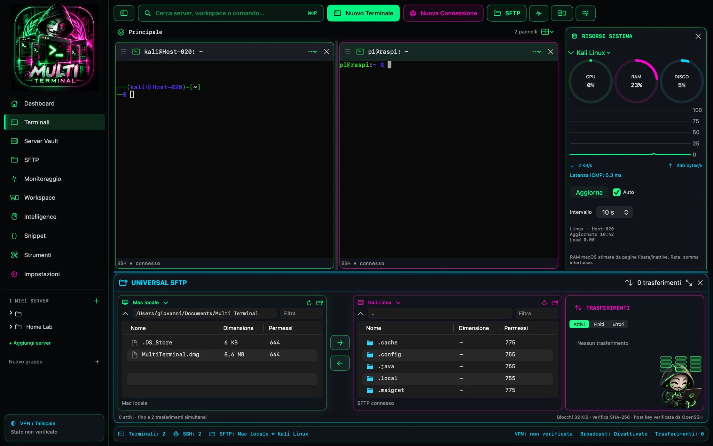

# MULTI TERMINAL

### One workspace. Multiple servers. Complete control.

**A futuristic SSH & SFTP workspace for macOS**

  

## Overview

**Multi Terminal** brings multiple remote connections into one modern macOS application. Work across SSH sessions, manage saved servers, browse files over SFTP, and view remote system resources without constantly switching windows.

Its dark interface combines neon green and magenta accents with a practical, multi-panel layout.

## Features

| Feature | Description |
| --- | --- |
| **Multiple SSH terminals** | Work with more than one remote terminal at a time in split panels. |
| **Server Vault** | Organize and reuse saved server connection profiles. |
| **Universal SFTP** | Browse local and remote files in a dual-pane interface. |
| **File transfers** | Move files between local and remote locations; use supported remote-to-remote workflows. |
| **System monitoring** | View CPU, RAM, disk, and network indicators for a selected server. |
| **Workspaces** | Keep server sessions organized by task or project. |
| **Additional tools** | Access dedicated sections for snippets, monitoring, intelligence, and settings. |

> Some advanced features may depend on the installed version. Consult release notes for confirmed functionality.

## Screenshot

The screenshot shows two connected SSH sessions, a system resource panel, and the integrated SFTP file manager.

[Download releases]([https://github.com/DaNnO-r0x/Multi-Terminal/](https://github.com/DaNnO-r0x/Multi-Terminal/releases/tag/v1.0.0)) · [Repository](https://github.com/DaNnO-r0x/Multi-Terminal)

## Download & installation

1. Visit the [Releases page]([https://github.com/DaNnO-r0x/Multi-Terminal/](https://github.com/DaNnO-r0x/Multi-Terminal/releases/tag/v1.0.0)).
2. Download the `.dmg` file from the latest available release.
3. Open the DMG and move **Multi Terminal** to your Applications folder, if prompted.
4. Launch the app and configure your first server connection.

**Platform:** macOS. Check each release for supported macOS versions and architectures.

## Security notes

- Connect only to systems you own or are authorized to administer.
- Never commit passwords, SSH private keys, API tokens, or server credentials.
- Review SSH host key fingerprints before trusting unfamiliar servers.

## Project status

Multi Terminal is under active development. Features, availability, and compatibility may change between releases.

---

**Built for developers, system administrators, and cybersecurity professionals.**

